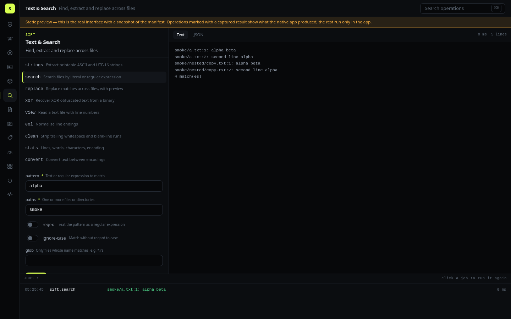

<div align="center">


# savehorse

**One bench, thirteen tools.**

A Rust workspace that folds twenty-two small Windows utilities into thirteen
modules behind one command line and one desktop app.

[](https://github.com/drsamonline/savehorse/actions/workflows/ci.yml)
[](https://github.com/drsamonline/savehorse/actions/workflows/desktop.yml)


[](LICENSE)

[**Landing page**](https://drsamonline.github.io/savehorse/) ·
[**Interface demo**](https://drsamonline.github.io/savehorse/demo/) ·
[Plan](PLAN.md) ·
[Capability matrix](docs/CAPABILITY-MATRIX.md)

</div>



<div align="center"><sub>The real interface, running against the real operation manifest — <a href="https://drsamonline.github.io/savehorse/demo/">try it in the browser</a>.</sub></div>

---

## What it is

The name comes from the shave horse: the bench a chairmaker sits on, which
clamps the work with a foot pedal so both hands stay free for the tool. One
bench, thirteen tools, each keeping the name it had on its own.

The portfolio this replaces was twenty-two applications — `aegis`, `vault`,
`sift`, `slate`, `halo`, `optic` and the rest — that shared one architecture and
15,000 lines of duplicated Win32 window code. The logic was worth keeping. The
GUI layer was not.

Three rules hold the project together:

| | |
|---|---|
| **One manifest** | Every operation is declared once, in `savehorse-registry`. The CLI's parser and help, the app's forms, and the numbers on this page all read from it. A test asserts the count, so the documentation cannot drift from the code. |
| **One runner** | The command line and the window call the same implementation. Neither owns logic, so a fix lands in both at once. |
| **Nothing pretends** | An operation declared but not yet ported refuses by name. Destructive operations preview before they write. Where an original was a simulation, it says so. |

## Status

A migration in progress, not a finished product.

| | |
|---|---|
| Modules | 13 |
| Operations declared | 87 |
| Operations ported and tested | **68** |
| Tests, on Windows, macOS and Linux | 142 |
| Desktop app | Tauri 2 + React |
| Licence | PolyForm Noncommercial 1.0.0 |

Ported so far: `sift` 9/9, `forge` 6/6, `revive` 7/7, `morph` 2/2, `glyph` 6/6,
`iris` 8/8, `arc` 10/10, `halo` 7/7, `scout` 6/6, `aegis` 5/6, `pulse` 2/7.
Still to come: the rest of `pulse` (5) and `pager` (9), which need cross-platform
system and window APIs, `flux` (4), and `aegis.persistence` (1), which is a
Windows registry audit.

## Quick start

```sh
git clone https://github.com/drsamonline/savehorse
cd savehorse

cargo build --workspace
cargo test --workspace
cargo run -- --help
```

### The desktop app

```sh
cd apps/savehorse-desktop
npm install
npm run tauri dev      # the window, wired to the Rust core
npm run build          # type-check and build the interface alone
```

The interface is a custom design system — tokens in
`apps/savehorse-desktop/src/styles/tokens.css` — with no utility framework and
no webfont request, so it works offline like everything else here.

## Use

```
savehorse <module> <op> [arguments] [flags]

savehorse modules                 list the thirteen modules
savehorse ops [module]            list operations and their status
savehorse <module> --help         what one module can do
```

```sh
# find a string across a tree, as a literal or a regex
savehorse sift search "TODO" ./src --regex

# replace across files — preview first, then apply
savehorse sift replace old_name new_name ./src --dry-run
savehorse sift replace old_name new_name ./src --backup

# catalogue a folder, then reclaim the duplicates
savehorse scout catalog ~/Pictures --format markdown --out catalog.md
savehorse scout duplicates ~/Downloads
savehorse scout clean ~/Downloads --commit

# build an ISO, verify it, then snapshot it
savehorse halo create ./disc --out disc.iso --volume-id BACKUP
savehorse halo verify disc.iso
savehorse revive pack ./disc --out disc.chronos

# carve files out of a blob, and read a PE header
savehorse revive carve disk.img --out recovered
savehorse forge inspect app.exe

# rename a batch, with an undo journal
savehorse morph rename ./photos --case title --number --journal undo.json
savehorse morph undo undo.json
```

### Flags

| Flag | Meaning |
|---|---|
| `--json` | machine-readable output on stdout |
| `--dry-run` | preview a destructive operation, change nothing |
| `--commit` | apply a destructive operation |
| `--backup` | keep a `.bak` copy before rewriting a file |
| `--regex` | treat the pattern as a regular expression |
| `--ignore-case` | case-insensitive matching |
| `--glob` | restrict to matching file names, e.g. `*.rs` |

Flags take a value as `--key value` or `--key=value`. Switches are read from the
manifest, so a new operation's booleans work without touching the CLI.

## The modules

| Module | Job | Replaces | Ported |
|---|---|---|---|
| `aegis` | Encrypt, shred, scan and audit | aegis + vault | 5 / 6 |
| `forge` | Inspect and patch executables | forge | 6 / 6 |
| `halo` | Author, read and convert disc images | halo + optic | 7 / 7 |
| `iris` | Inspect, convert and transform images | iris + prism | 8 / 8 |
| `arc` | Pack, split, join and transfer | arc + vortex | 10 / 10 |
| `sift` | Find, extract and replace across files | sift + slate | 9 / 9 |
| `glyph` | PDF, Markdown and readability | glyph | 6 / 6 |
| `scout` | Catalogue, deduplicate and compare | scout + strata | 6 / 6 |
| `morph` | Batch rename with preview and undo | morph + strata | 2 / 2 |
| `pulse` | Hardware, processes and maintenance | pulse + beacon | 2 / 7 |
| `pager` | Snap, pin and arrange windows | pager + dock | 0 / 9 |
| `revive` | Carve, recover and verify snapshots | revive + chronos | 7 / 7 |
| `flux` | Inspect, tag and shape audio | flux | 0 / 4 |

## Layout

```
crates/savehorse-core        errors, sizes, hashing, walking, path safety
crates/savehorse-registry    the operation manifest — declared once, read by all
crates/savehorse-runner      one implementation of every ported operation
crates/savehorse-sift        text, search and the slate-derived text ops
crates/savehorse-scout       filesystem catalogue and deduplication
crates/savehorse-glyph       PDF, Markdown, measurements
crates/savehorse-halo        ISO 9660 authoring and reading
crates/savehorse-iris        images
crates/savehorse-arc         zip archives and volume splitting
crates/savehorse-revive      signature carving and snapshot containers
crates/savehorse-forge       PE headers, hex and patching
crates/savehorse-morph       batch rename with an undo journal
apps/savehorse-cli           the `savehorse` binary
apps/savehorse-desktop       the Tauri window (React + TypeScript)
index.html, demo/, assets/   landing page, interface demo, screenshots
docs/                        capability matrix and decision records
```

Module crates hold logic only. They return data or an error and never print,
which is what lets one implementation serve both front ends.

## Documentation

- [PLAN.md](PLAN.md) — the consolidation plan: what the 22 applications were,
  how they map onto 13 modules, and the phased migration.
- [docs/CAPABILITY-MATRIX.md](docs/CAPABILITY-MATRIX.md) — every operation, its
  status, and the defects fixed rather than carried forward.
- [docs/decisions](docs/decisions/0001-decisions.md) — the choices that are
  expensive to reverse, with what was rejected and why.

## Licence

[PolyForm Noncommercial 1.0.0](LICENSE). Noncommercial use only — if that ever
needs to change, it has to change before the first public release, because
permission already granted cannot be withdrawn.
