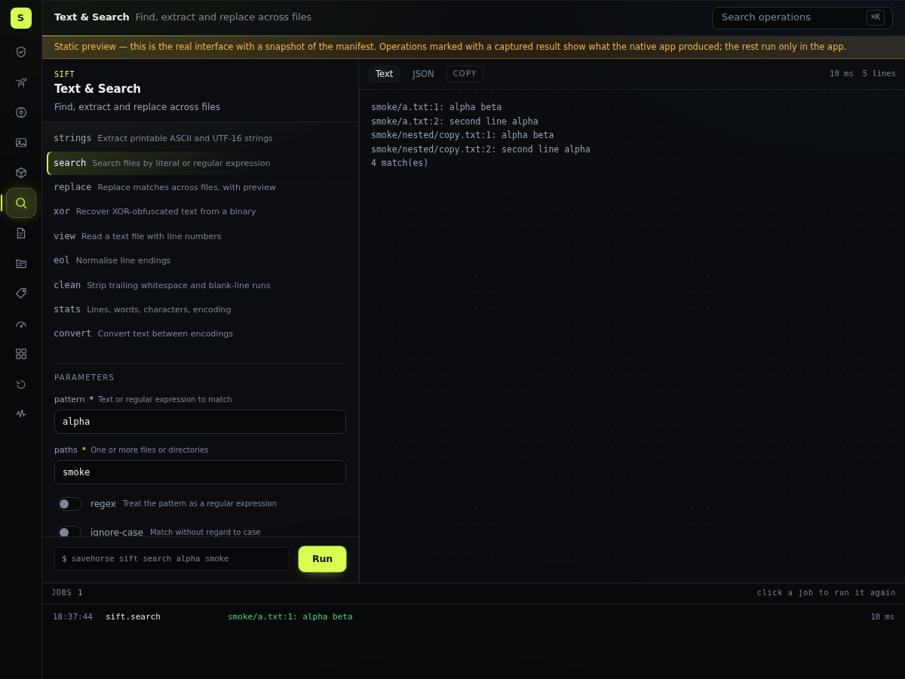

<div align="center">


# savehorse

<!-- shot:start -->



<!-- shot:end -->

**One bench, thirteen tools.**

[](https://github.com/drsamonline/savehorse/actions/workflows/ci.yml)
[](https://github.com/drsamonline/savehorse/actions/workflows/desktop.yml)


[](LICENSE)

[**User guide**](USER_GUIDE.md) ·
[**Landing page**](https://drsamonline.github.io/savehorse/) ·
[**Interface demo**](https://drsamonline.github.io/savehorse/demo/) ·
[Plan](PLAN.md) ·
[Capability matrix](docs/CAPABILITY-MATRIX.md)

</div>


I had twenty-two small Windows utilities. They shared one architecture and about
fifteen thousand lines of window code between them, and every time I fixed a bug
I fixed it twice or forgot to. This is those twenty-two folded into thirteen
modules behind one command line and one desktop app.

The name comes from the shave horse: the bench a chairmaker sits on, which holds
the work with a foot pedal so both hands stay free for the tool.

## Who it's for

| If you are | Start with | Because |
|---|---|---|
| Anyone who has lost files | `revive` | Carves images, PDFs and ZIPs back out of a disk image or a corrupted file |
| A photographer or designer | `iris` | Batch converts a folder, makes contact sheets, builds `.ico` files |
| A developer in a codebase | `sift` | Regex search across a tree, replace with a preview first |
| Reading or writing documents | `glyph` | PDF in and out, Markdown rendering, readability |
| A sysadmin or support tech | `pulse`, `halo` | Hash a file, audit temp storage, build or verify an ISO |
| Cleaning a full disk | `scout` | What is taking the space, and which files are byte-identical |
| Handling private files | `aegis` | Encrypt, shred, audit autostart entries |
| Forensics, or learning security | `forge`, `sift` | PE headers, hex, byte patching, XOR recovery |
| Just want files organised | `morph`, `arc` | Rename a batch with an undo journal, pack or split archives |
| A musician or audio tinkerer | `flux` | WAV and ID3 metadata, test tones, gain |

The [user guide](USER_GUIDE.md) has a longer version of that table, five worked
examples, and a reference for every operation.

## Where it is

All 87 operations are ported and tested, and all thirteen modules are complete.

| | |
|---|---|
| Modules | 13 |
| Operations declared | 87 |
| Operations ported and tested | **87** |
| Tests, on Windows, macOS and Linux | 179 |
| Desktop app | Tauri 2 + React |
| Licence | PolyForm Noncommercial 1.0.0 |

Every operation is declared in the manifest whether or not it is ported, and an
unported one refuses by name instead of failing somewhere deeper. `savehorse ops`
is the authoritative list, generated from the same manifest the program runs on.

## Install

Download an installer from [releases](https://github.com/drsamonline/savehorse/releases),
or build it:

```sh
git clone https://github.com/drsamonline/savehorse
cd savehorse
cargo build --release -p savehorse-cli     # the command line
```

The desktop app:

```sh
cd apps/savehorse-desktop
npm install
npm run tauri dev
```

## A few commands

```
savehorse <module> <operation> [arguments] [flags]
```

```sh
savehorse sift search "TODO" ./src --regex
savehorse sift replace old_name new_name ./src --dry-run
savehorse scout duplicates ~/Downloads
savehorse aegis encrypt notes.txt --out notes.vault --passphrase "..."
savehorse halo create ./disc --out disc.iso --volume-id BACKUP
savehorse morph rename ./photos --case title --number --journal undo.json
```

Flags take a value as `--out file` or `--out=file`. Switches stand alone, like
`--dry-run`. Anything that rewrites or destroys data previews when you ask it
to; the user guide lists which, and what each preview shows.

## The modules

| Module | Job | Replaces | Ported |
|---|---|---|---|
| `aegis` | Encrypt, shred, scan and audit | aegis + vault | 6 / 6 |
| `forge` | Inspect and patch executables | forge | 6 / 6 |
| `halo` | Author, read and convert disc images | halo + optic | 7 / 7 |
| `iris` | Inspect, convert and transform images | iris + prism | 8 / 8 |
| `arc` | Pack, split, join and transfer | arc + vortex | 10 / 10 |
| `sift` | Find, extract and replace across files | sift + slate | 9 / 9 |
| `glyph` | PDF, Markdown and readability | glyph | 6 / 6 |
| `scout` | Catalogue, deduplicate and compare | scout + strata | 6 / 6 |
| `morph` | Batch rename with preview and undo | morph + strata | 2 / 2 |
| `pulse` | Hardware, processes and maintenance | pulse + beacon | 7 / 7 |
| `pager` | Snap, pin and arrange windows | pager + dock | 9 / 9 |
| `revive` | Carve, recover and verify snapshots | revive + chronos | 7 / 7 |
| `flux` | Inspect, tag and shape audio | flux | 4 / 4 |

## How it holds together

Three things do most of the work.

**One manifest.** Every operation is declared once, in `savehorse-registry`, with
its parameters, danger level and status. The CLI's argument parser and help, the
app's forms, and the counts in this README all read from it. A test asserts the
count, so the documentation cannot quietly go stale.

**One runner.** The command line and the window call the same code. Neither owns
logic, so a fix lands in both at once.

**Nothing pretends.** Unported operations refuse by name. Destructive ones
preview before they write. Where an original turned out to be a simulation, the
summary says so.

```
crates/savehorse-core        errors, sizes, hashing, walking, path safety
crates/savehorse-registry    the operation manifest
crates/savehorse-runner      one implementation of every ported operation
crates/savehorse-<module>    thirteen module crates, logic only, no printing
apps/savehorse-cli           the `savehorse` binary
apps/savehorse-desktop       the Tauri window (React + TypeScript)
```

Module crates return data or an error and never print. That is what lets one
implementation serve both front ends.

## Documentation

- [USER_GUIDE.md](USER_GUIDE.md) — how to use it: audiences, worked examples,
  every operation, and what previews.
- [PLAN.md](PLAN.md) — the consolidation plan: what the 22 applications were, how
  they map onto 13 modules, and the phased migration.
- [docs/CAPABILITY-MATRIX.md](docs/CAPABILITY-MATRIX.md) — every operation, its
  status, and the defects fixed rather than carried forward.
- [docs/decisions](docs/decisions/0001-decisions.md) — the choices that are
  expensive to reverse, with what was rejected.
- [CHANGELOG.md](CHANGELOG.md) — what changed and when.

<!-- support:sweep -->
## Support

| | |
|---|---|
| UPI (India) | `drsohilboi@ybl` — payee Dr Sohil Momin, open amount, or scan [the QR](docs/assets/upi-qr.svg) |
| GitHub Sponsors | [github.com/sponsors/drsamonline](https://github.com/sponsors/drsamonline) |
| Ko-fi | [ko-fi.com/matneo](https://ko-fi.com/matneo) |
| PayPal | [paypal.me/drsohilmomin](https://paypal.me/drsohilmomin?locale.x=en_GB&country.x=IN) |
| My books | [Amazon author store](https://www.amazon.com/stores/author/B08ZT331LY/allbooks?ccs_id=aed72b9f-71d9-41dc-adee-e9368a317acc) |
| More apps | [drsamonline.github.io](https://drsamonline.github.io/) |
| Email | [sohilmomin2000@gmail.com](mailto:sohilmomin2000@gmail.com) |

## Licence

[PolyForm Noncommercial 1.0.0](LICENSE). Noncommercial use only. If that ever
needs to change it has to change before the first public release, because
permission already granted cannot be taken back.
